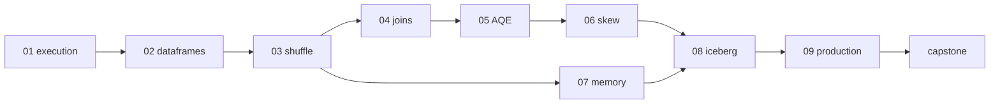

# Roadmap

## Target competencies

| Competency | Labs |
| --- | --- |
| Develop production Spark ETL | 02, 08, 09, capstone |
| Understand Spark execution | 01, 03 |
| Read physical plans | 02, 03, 04, 05 |
| Use the Spark UI | 01, 03, 06, 07 |
| Diagnose slow Spark jobs | 06, 07, 09 |
| Optimize joins and shuffles | 03, 04, 05 |
| Recognize and fix data skew | 05, 06 |
| Understand executor memory, spill, and OOM | 07 |
| Build efficient Spark + Iceberg pipelines | 08, capstone |
| Answer senior Data Engineer Spark interview questions | all |

## Labs

| Lab | Focus | Done when I can… |
| --- | --- | --- |
| `01_execution_model` | Driver and executors; application → job → stage → task; lazy evaluation; partitions as the unit of parallelism | Predict the jobs, stages, and tasks of a simple pipeline and confirm them in the Spark UI |
| `02_dataframes` | Catalyst: logical → optimized → physical plan; `explain`; file scans, column and predicate pruning; whole-stage codegen | Read a physical plan end to end and map its operators to the Spark UI |
| `03_shuffle` | Narrow vs wide transformations; `Exchange`; stage boundaries; shuffle partitions; shuffle read/write metrics | Point at every shuffle in a plan and explain why it exists |
| `04_joins` | Broadcast hash, sort-merge, and shuffled hash joins; broadcast threshold; join hints | Choose a join strategy, force it, and verify it in the plan |
| `05_aqe` | Adaptive Query Execution: coalescing partitions, runtime join switching, skew-join splitting; initial vs final plan | Explain what AQE changed in a plan and why |
| `06_skew` | Spotting skew in task and shuffle metrics; limits of AQE skew handling; salting and hot-key isolation | Diagnose a skewed stage from the UI and fix it |
| `07_memory` | Executor memory layout; spill; driver vs executor OOM; broadcast and `collect` pressure; caching trade-offs | Diagnose spill and OOM from their symptoms and choose the right fix |
| `08_iceberg` | Spark + Iceberg catalogs; write distribution and file sizing; `MERGE INTO`; copy-on-write vs merge-on-read; maintenance; storage-partitioned joins | Build an idempotent incremental Iceberg pipeline with a healthy file layout |
| `09_production` | Packaging and `spark-submit`; configuration strategy; Airflow orchestration; backfills; testing; event logs and History Server | Systematically diagnose a slow or failing production job |
| `capstone` | End-to-end Spark + Iceberg pipeline on realistic, deliberately skewed data | Build it, break it, diagnose it, optimize it, and document before/after |

## Open decisions

- Runtime: Spark, Java, and Iceberg versions; Docker or WSL2 (native Windows Spark needs extra Hadoop binaries).
- How lab datasets are generated into `data/`, including skewed distributions.
- Standard shape of a lab directory.
